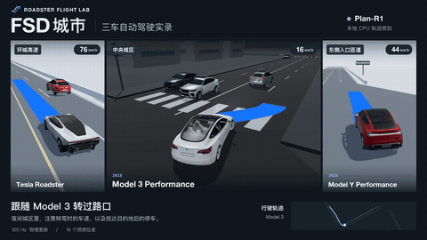
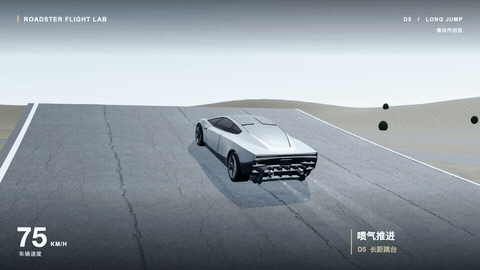

# Roadster Flight Lab

[English](README.md) · [简体中文](README.zh-CN.md) · [繁體中文](README.zh-TW.md) · **日本語** · [한국어](README.ko.md) · [Deutsch](README.de.md) · [Français](README.fr.md) · [Español](README.es.md) · [Português (Brasil)](README.pt-BR.md)

**ひとつの試験場で3台の違いを体感できます。Roadster でジェットを使ってジャンプし、Model 3 でバンク走行時の足回りを確かめ、Model Y ではローカルの経路予測モデルに街を走らせてみてください。**

[Download for Windows x64](https://github.com/colasun-ai/Roadster-Flight-Lab/releases/download/v0.10.1/Roadster-Flight-Lab-0.10.1-Windows-x64.exe) · [Download for Apple Silicon](https://github.com/colasun-ai/Roadster-Flight-Lab/releases/download/v0.10.1/Roadster-Flight-Lab-0.10.1-Mac-arm64.zip) · [Release notes and checksums](https://github.com/colasun-ai/Roadster-Flight-Lab/releases/tag/v0.10.1)

## シミュレーターの走行映像

| FSD 市街地走行 · Roadster、Model 3、Model Y | D5 ジャンプ台 · Roadster のジェットアシスト |
| --- | --- |
| [](https://colasun-ai.github.io/Roadster-Flight-Lab/media/fsd-city.mp4) | [](https://colasun-ai.github.io/Roadster-Flight-Lab/media/d5-jump.mp4) |
| [▶ 動画を再生 · 0:20](https://colasun-ai.github.io/Roadster-Flight-Lab/media/fsd-city.mp4) | [▶ 動画を再生 · 0:20](https://colasun-ai.github.io/Roadster-Flight-Lab/media/d5-jump.mp4) |


## 初めてのドライブ

テスラ ガレージでロードスターを選択し、運転開始を選択してから、スロープ パークを開いて D5 を選択します。ランプのプロファイルを検査し、その開始点にジャンプして、電力での走行を試してください。 Repeat it with Shift held for rear thrust.

**言語** · 英語が初期言語です。 Tesla Garage で言語を選択し、選択した言語でガレージを再度開きます。アプリはセッション間でそれを記憶します。メニュー、機器、コースの説明、ナビゲーション プロンプトはオフラインでも機能します。

## ガレージで

| 車両 | 何を試すか |
| --- | --- |
| Tesla Roadster | 10基のコールドガススラスタで加速、ホバリング、ロール、着地を試せます。飛行モードは Stabilized、Manual、Chaos の3種類。ガスタンクはコンプレッサーが自動で再充填します。 |
| 2018 Model 3 Performance | 標準、パフォーマンス、およびトラック モードを比較します。デュアルモーターAWDモデルは、回生ブレーキと摩擦ブレーキを組み合わせたものです。 450 馬力のリファレンスは、期間中の路上テストから来ています。 |
| 2026 Model Y Performance | 独自のパワーデリバリー、シャーシ、ダンピングを備えた米国市場向けの高性能 SUV を運転します。モデル 3 と同じコーナーまたは丘を撮影して、体の動きを比較します。 |

## サスペンションをテストする 20 の方法

スロープ パークには 4 つのエリアがあります。勾配 8 ～ 45% のヒル スタート、頂上と下り坂、バンクと車軸をクロスするセクション、およびさまざまな着地を持つジャンプです。レンダラーと物理エンジンは同じサーフェス頂点を使用します。 45% の勾配は、水平距離 100 m で 45 m 上昇します。


## 地元のプランナーに従って街を巡る

地図で目的地を選び、FSD を起動します。総延長61.43 kmの道路網には高速道路、側道、ランプ、トンネル、転回路があります。Plan-R1 は今後8秒間の車両の位置と向きを16点で予測します。制御系が交通状況に応じて制動しながら選択した軌道を追従し、車の前方にはその直近の区間が青い帯で表示されます。WASD またはスペースキーでいつでも手動運転に戻れます。


## キーボードコントロール

| 鍵 | アクション |
| --- | --- |
| W / S · A / D | 加速、ブレーキ、または後進。左または右に操縦する |
| Space | ハンドブレーキ;シティモードで引き継ぐ |
| C · R · Esc | サイクルカメラ。車をリセットします。ガレージを開ける |
| Shift · J / K · H | リアブースト;垂直ジェット。ホバーを切り替えます |
| T | ロードスターのフライト モードまたはモデル 3 のドライブ モードを変更する |

## デスクトップのダウンロード

Intel または AMD CPU を搭載した Windows 11 では、ポータブル EXE をダブルクリックします。抽出用に約 3 GB の一時スペースを確保してください。実行可能ファイルは署名されていないため、Windows では発行元不明のプロンプトが表示される場合があります。

Apple Silicon Mac では、ZIP を解凍してアプリを開きます。これにはアドホック署名があり、Apple によって公証されていません。どちらのデスクトップ パッケージにも、車両、テクスチャ、物理エンジン、CPU プランナーが含まれています。

## 測定されたもの

レイピアは固定 120 Hz で動作します。 3 台の車はそれぞれ、60 回の走行で物理回帰の 20 コースすべてを完了しました。 1,788 の光線サンプルにわたって、衝突と目に見える斜面の高さは 3 mm 以内で一致しました。以前のロードスターシミュレータテストでは、電気による0-100km/h発進で3.502秒、ジェットアシストで1.0411秒を記録した。これらはシミュレータの結果です。 [勾配検証データ](reports/slope-park/驾驶验证.md)

## ソースからビルドする

npm では Node.js 22.12 以降を使用してください。リポジトリには、オリジナルのモデル、ドライブ対応メッシュ、テクスチャ、アクションボキャブラリー、および Plan-R1 チェックポイントが含まれています。最初の依存関係のインストールにはインターネット アクセスが必要です。

```sh
git clone https://github.com/colasun-ai/Roadster-Flight-Lab.git
cd Roadster-Flight-Lab
npm ci
npm run dev
```

Windows x64: Python 3.10 以降を使用して組み込みランタイムを準備し、実際の推論を検証してから、ポータブル EXE を作成します。

```sh
python scripts/fsd/prepare_windows_runtime.py
node scripts/fsd/smoke_portable.cjs
npm run pack:win
```

Apple Silicon: ランタイムを準備して署名付きアプリをビルドする前に、Xcode コマンドライン ツールと uv をインストールします。

```sh
python3 scripts/fsd/bootstrap.py
npm run pack:mac
```

### 回帰スイートを実行する

```sh
npm test
npm run test:vehicles
npm run test:fsd
node tests/slope-park.test.js
```

デスクトップ パッケージは、desktop-build ディレクトリに書き込まれます。印刷ディレクトリには、1:24 ロードスター 3MF とそのリビルド スクリプトが含まれています。

## クレジットとライセンス

asiphy007、Ameer Studio、BloxBloger、vecarz / heynic による車両モデル。この都市は、Peixin による歴史的な DriveScene Studio 環境を適応させ、Poly Haven 地面テクスチャを使用しています。現地計画は Xiaolong Tang らによる Plan-R1 に基づいています。モデル Y アセットは CC BY-NC 4.0 であり、非営利使用に限定されています。アップストリーム チェックポイントには、別途記載されたライセンスはありません。 Roadster Flight Lab は独立したシミュレータです。 [オリジナルの資産、ライセンス、および変更](CREDITS.md)
