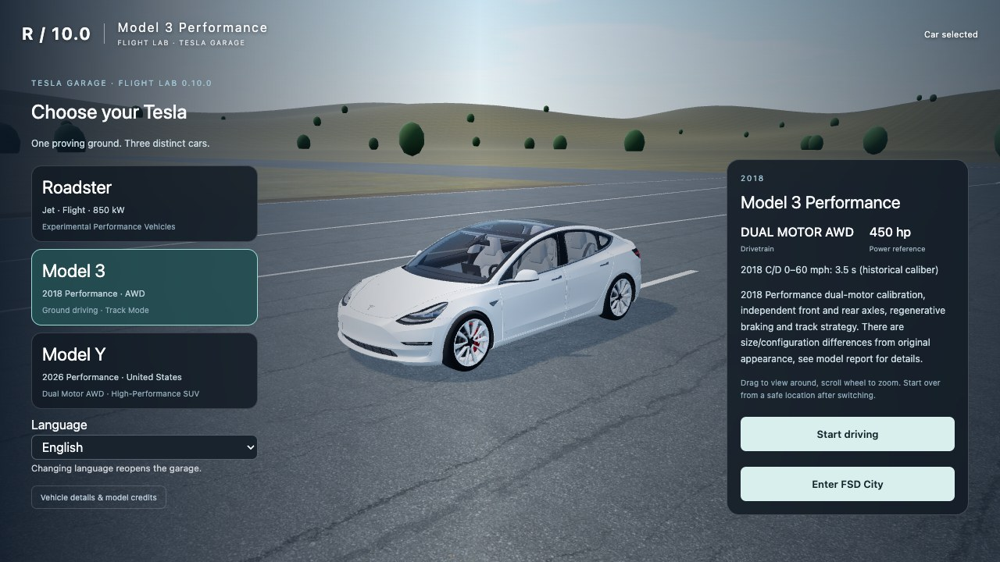

# Roadster Flight Lab

[English](README.md) · [简体中文](README.zh-CN.md) · [繁體中文](README.zh-TW.md) · [日本語](README.ja.md) · **한국어** · [Deutsch](README.de.md) · [Français](README.fr.md) · [Español](README.es.md)

**하나의 시험장에서 세 대를 비교해 보세요. Roadster로 제트 점프를 하고, Model 3로 경사진 코너에서 서스펜션 반응을 느껴 보세요. Model Y에서는 내장 주행 모델이 도심에서 어떤 경로를 고르는지 볼 수 있습니다.**

[Windows x64용 다운로드](https://github.com/colasun-ai/Roadster-Flight-Lab/releases/download/v0.10.0/Roadster-Flight-Lab-0.10.0-Windows-x64.exe) · [Apple Silicon용 다운로드](https://github.com/colasun-ai/Roadster-Flight-Lab/releases/download/v0.10.0/Roadster-Flight-Lab-0.10.0-Mac-arm64.zip) · [릴리스 노트 및 체크섬](https://github.com/colasun-ai/Roadster-Flight-Lab/releases/tag/v0.10.0)



## 첫 번째 드라이브

Tesla Garage에서 Roadster를 선택하고 Start Driving을 선택한 다음 슬로프 파크를 열고 D5를 선택합니다. 램프 프로필을 검사하고 시작점으로 점프한 후 전력으로 주행해 보세요. 후방 추력을 위해 Shift를 누른 상태에서 이를 반복합니다.

**언어** · 영어가 초기 언어입니다. 원하는 대로 차고를 다시 열려면 Tesla Garage에서 언어를 선택하세요. 앱은 세션 간에 이를 기억합니다. 메뉴, 도구, 코스 설명 및 탐색 프롬프트는 오프라인에서 작동합니다.

## 차고 안

| 차량 | 무엇을 시도해 볼 것인가? |
| --- | --- |
| Tesla Roadster | 10개의 저온 가스 노즐을 사용하여 부스트, 호버링, 롤링 및 착륙을 수행합니다. 안정화 비행, 수동 비행, 카오스 비행 간을 전환합니다. 온보드 압축기는 지속적으로 탱크를 다시 채웁니다. |
| 2018 Model 3 Performance | 표준, 성능 및 트랙 모드를 비교합니다. 듀얼 모터 AWD 모델은 회생 제동과 마찰 제동을 혼합합니다. 450마력 기준은 기간 도로 테스트에서 나온 것입니다. |
| 2026 Model Y Performance | 자체 전력 공급, 섀시 및 댐핑을 통해 미국 시장 성능 SUV를 구동합니다. Model 3와 동일한 코너나 언덕을 주행하여 신체 움직임을 비교하세요. |

## 서스펜션을 테스트하는 20가지 방법

슬로프 공원에는 8~45% 경사도의 언덕 시작, 마루 및 딥, 뱅크 및 크로스 액슬 섹션, 다양한 착지가 있는 점프 등 4개 영역이 있습니다. 렌더러와 물리 엔진은 동일한 표면 정점을 사용합니다. 45% 경사도는 수평 거리 100m에서 45m 상승합니다.


## 지역 계획가를 따라 도시를 여행하세요.

지도에서 목적지를 선택하고 FSD를 참여시킵니다. 61.43km의 도로망에는 고속도로, 서비스 도로, 경사로, 터널 및 유턴 연결이 포함됩니다. Plan-R1은 8초에 걸쳐 16개의 포즈를 예측합니다. 컨트롤러는 선택한 궤적을 따르고 교통 및 제동 안전 장치를 적용합니다. 파란색 리본은 계획의 가까운 부분을 보여줍니다. WASD나 스페이스바로 언제든지 제어할 수 있습니다.


## 키보드 컨트롤

| 키 | 액션 |
| --- | --- |
| W / S · A / D | 가속, 제동 또는 후진; 왼쪽이나 오른쪽으로 조종해 |
| Space | 핸드브레이크; 도시 모드에서 장악 |
| C · R · Esc | 사이클 카메라; 차를 재설정하십시오. 차고를 열어라 |
| Shift · J / K · H | 후방 부스트; 수직 제트기; 호버 토글 |
| T | Roadster의 비행 모드 또는 Model 3의 운전 모드 변경 |

## 데스크탑 다운로드

Intel 또는 AMD CPU가 탑재된 Windows 11에서는 휴대용 EXE를 두 번 클릭합니다. 추출을 위해 약 3GB의 임시 공간을 허용합니다. 실행 파일이 서명되지 않았으므로 Windows에서 알 수 없는 게시자 프롬프트가 표시될 수 있습니다.

Apple Silicon Mac에서 ZIP 압축을 풀고 앱을 엽니다. 임시 서명이 있으며 Apple에서 공증을 받지 않았습니다. 두 데스크탑 패키지 모두 차량, 텍스처, 물리 엔진 및 CPU 플래너를 포함합니다.

## 측정된 내용

Rapier가 고정된 120Hz로 실행됩니다. 세 대의 자동차 각각은 물리학 회귀 분석에서 60회 실행에 대한 20개 코스를 모두 완료했습니다. 1,788개의 광선 샘플에서 충돌 및 눈에 보이는 경사 높이는 3mm 이내로 일치했습니다. 이전 로드스터 시뮬레이터 테스트에서는 전기 0~100km/h 발사의 경우 3.502초, 제트 지원의 경우 1.0411초를 기록했습니다. 시뮬레이터 결과입니다. [경사 검증 데이터](reports/slope-park/驾驶验证.md)

## 소스에서 빌드

npm과 함께 Node.js 22.12 이상을 사용하세요. 저장소에는 원본 모델, 드라이브 지원 메시, 텍스처, 액션 어휘 및 Plan-R1 체크포인트가 포함되어 있습니다. 첫 번째 종속성 설치에는 인터넷 액세스가 필요합니다.

```sh
git clone https://github.com/colasun-ai/Roadster-Flight-Lab.git
cd Roadster-Flight-Lab
npm ci
npm run dev
```

Windows x64: Python 3.10 이상을 사용하여 임베디드 런타임을 준비하고 실제 추론을 확인한 다음 이식 가능한 EXE를 만듭니다.

```sh
python scripts/fsd/prepare_windows_runtime.py
node scripts/fsd/smoke_portable.cjs
npm run pack:win
```

Apple Silicon: 런타임을 준비하고 서명된 앱을 구축하기 전에 Xcode 명령줄 도구와 uv를 설치합니다.

```sh
python3 scripts/fsd/bootstrap.py
npm run pack:mac
```

### 회귀 스위트 실행

```sh
npm test
npm run test:vehicles
npm run test:fsd
node tests/slope-park.test.js
```

데스크탑 패키지가 데스크탑 빌드 디렉토리에 기록됩니다. 인쇄 디렉토리에는 1:24 Roadster 3MF와 재구축 스크립트가 포함되어 있습니다.

## 크레딧 및 라이선스

asiphy007, Ameer Studio, BloxBloger 및 vecarz / heynic의 차량 모델. 이 도시는 Peixin의 역사적인 DriveScene Studio 환경을 채택하고 Poly Haven 지상 텍스처를 사용합니다. 지역 계획은 Xiaolong Tang과 동료들의 Plan-R1을 기반으로 합니다. Model Y 자산은 CC BY-NC 4.0이며 비상업적 용도로 제한됩니다. 업스트림 체크포인트에는 별도로 명시된 라이선스가 없습니다. Roadster Flight Lab은 독립적인 시뮬레이터입니다. [원본 자산, 라이센스 및 수정 사항](CREDITS.md)
