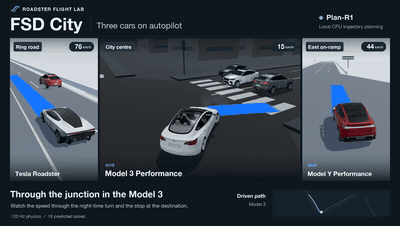
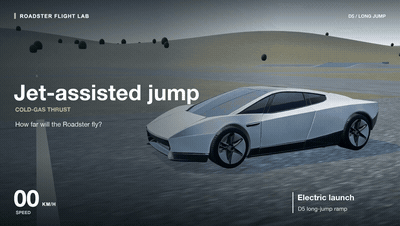
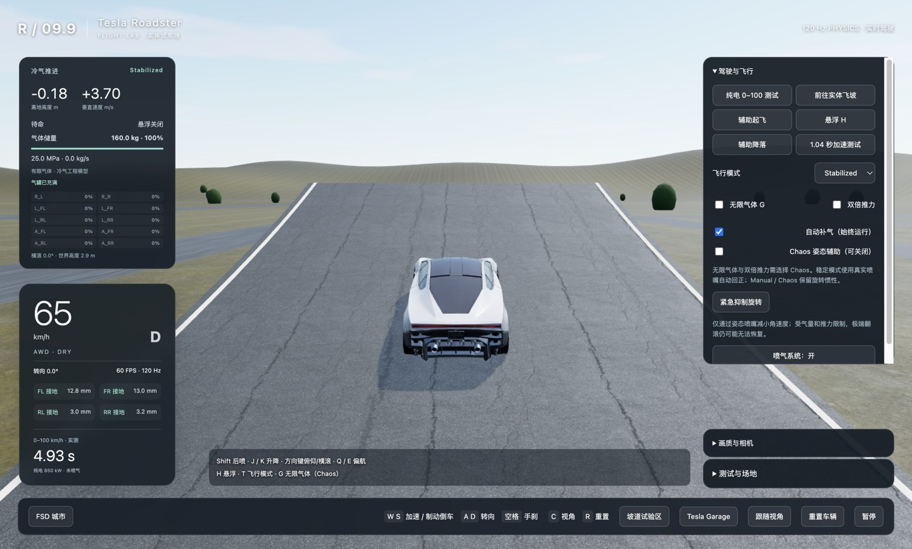
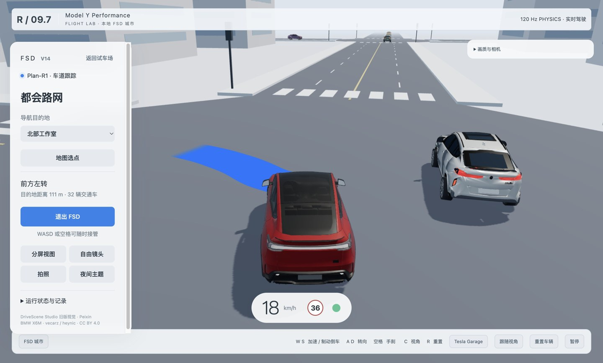

# Roadster Flight Lab

**English** · [简体中文](README.zh-CN.md) · [繁體中文](README.zh-TW.md) · [日本語](README.ja.md) · [한국어](README.ko.md) · [Deutsch](README.de.md) · [Français](README.fr.md) · [Español](README.es.md) · [Português (Brasil)](README.pt-BR.md)

**Three cars, one proving ground. Launch a jet-assisted Roadster, feel a Model 3 load up its suspension on a banked bend, or let a local trajectory model navigate the city in a Model Y.**

[Windows 64-bit · Intel / AMD](https://github.com/colasun-ai/Roadster-Flight-Lab/releases/download/v0.10.1/Roadster-Flight-Lab-0.10.1-Windows-x64.exe) · [Mac · Apple Silicon](https://github.com/colasun-ai/Roadster-Flight-Lab/releases/download/v0.10.1/Roadster-Flight-Lab-0.10.1-Mac-arm64.zip) · [Mac · Intel](https://github.com/colasun-ai/Roadster-Flight-Lab/releases/download/v0.10.1/Roadster-Flight-Lab-0.10.1-Mac-x64.zip) · [Windows 32-bit · Driving Edition (no FSD)](https://github.com/colasun-ai/Roadster-Flight-Lab/releases/download/v0.10.1/Roadster-Flight-Lab-0.10.1-Windows-x86-Driving.exe) · [Release notes and checksums](https://github.com/colasun-ai/Roadster-Flight-Lab/releases/tag/v0.10.1)

The three 64-bit builds include local FSD. The Windows x64 EXE also passed garage, city and planner checks under Windows 11 on Arm using emulation. The 32-bit edition includes all three cars, the proving ground and Roadster jets. It was tested as a 32-bit process on 64-bit Windows.

## Watch the simulator in motion

| FSD City · Roadster, Model 3 and Model Y | D5 · Jet-assisted Roadster jump |
| --- | --- |
| [](https://colasun-ai.github.io/Roadster-Flight-Lab/media/en/fsd-city.mp4) | [](https://colasun-ai.github.io/Roadster-Flight-Lab/media/en/d5-jump.mp4) |
| [▶ Watch the full film · 0:20](https://colasun-ai.github.io/Roadster-Flight-Lab/media/en/fsd-city.mp4) | [▶ Watch the full film · 0:20](https://colasun-ai.github.io/Roadster-Flight-Lab/media/en/d5-jump.mp4) |


## Your first drive

Choose Roadster in Tesla Garage, select Start driving, then open the slope park and choose D5. Inspect the ramp profile, jump to its starting point and try the run on electric power. Repeat it with Shift held for rear thrust.

**Language** · English is the initial language. Select a language in Tesla Garage to reopen the garage with your choice. The app remembers it between sessions. Menus, instruments, course descriptions and navigation prompts work offline.

## In the garage

| Vehicle | What to try |
| --- | --- |
| Tesla Roadster | Use ten cold-gas nozzles to boost, hover, roll and land. Switch between Stabilized, Manual and Chaos flight. An onboard compressor continuously refills the tanks. |
| 2018 Model 3 Performance | Compare Standard, Performance and Track modes. The dual-motor AWD model blends regenerative and friction braking. The 450 hp reference comes from a period road test. |
| 2026 Model Y Performance | Drive the US-market performance SUV with its own power delivery, chassis and damping. Take the same corner or hill as the Model 3 to compare body motion. |

## Twenty ways to test a suspension

The slope park has four areas: hill starts on 8–45% grades, crests and dips, banked and cross-axle sections, and jumps with different landings. The renderer and physics engine use the same surface vertices. A 45% grade rises 45 m over 100 m of horizontal distance.



## Follow a local planner through the city

Pick a destination on the map and engage FSD. The 61.43 km road network includes expressways, service roads, ramps, tunnels and U-turn connections. Plan-R1 predicts sixteen poses spanning eight seconds. The controller follows the selected trajectory and applies traffic and braking safeguards. The blue ribbon shows the near part of the plan. Take over at any time with WASD or the space bar.



## Keyboard controls

| Keys | Action |
| --- | --- |
| W / S · A / D | Accelerate, brake or reverse; steer left or right |
| Space | Handbrake; take over in city mode |
| C · R · Esc | Cycle camera; reset the car; open the garage |
| Shift · J / K · H | Rear boost; vertical jets; toggle hover |
| T | Change flight mode on the Roadster or drive mode on the Model 3 |

## Desktop downloads

On Windows 11 with an Intel or AMD CPU, double-click the portable EXE. Allow about 3 GB of temporary space for extraction. The executable is unsigned, so Windows may show an unknown-publisher prompt.

On a Mac, unpack the ZIP for your processor and open the app. Both Mac builds are ad-hoc signed and have not been notarized by Apple.

## What has been measured

Rapier runs at a fixed 120 Hz. Each of the three cars completed all twenty courses in a physics regression, for sixty runs. Across 1,788 ray samples the collision and visible slope heights agreed within 3 mm. Earlier Roadster simulator tests recorded 3.502 s for an electric 0–100 km/h launch and 1.0411 s with jet assistance. These are simulator results. [Slope validation data](reports/slope-park/驾驶验证.md)

## Build from source

Use Node.js 22.12 or newer with npm. The repository includes original models, drive-ready meshes, textures, the action vocabulary and the Plan-R1 checkpoint. The first dependency installation requires internet access.

```sh
git clone https://github.com/colasun-ai/Roadster-Flight-Lab.git
cd Roadster-Flight-Lab
npm ci
npm run dev
```

Windows x64: use Python 3.10 or later to prepare the embedded runtime, verify real inference, then create the portable EXE.

```sh
python scripts/fsd/prepare_windows_runtime.py
node scripts/fsd/smoke_portable.cjs
npm run pack:win
```

Apple Silicon: install the Xcode command-line tools and uv before preparing the runtime and building the signed app.

```sh
python3 scripts/fsd/bootstrap.py
npm run pack:mac
```

**Intel Mac (x64)** · `python3 scripts/fsd/prepare_mac_intel_runtime.py` → `npm run pack:mac`

**Windows x86** · `npm run pack:win32`

### Run the regression suites

```sh
npm test
npm run test:vehicles
npm run test:fsd
node tests/slope-park.test.js
```

Desktop packages are written to the desktop-build directory. The print directory contains the 1:24 Roadster 3MF and its rebuild script.

## Credits and licensing

Vehicle models by asiphy007, Ameer Studio, BloxBloger and vecarz / heynic. The city adapts the historical DriveScene Studio environment by Peixin and uses Poly Haven ground textures. Local planning is based on Plan-R1 by Xiaolong Tang and colleagues. The Model Y asset is CC BY-NC 4.0 and is limited to noncommercial use. The upstream checkpoint has no separately stated license. Roadster Flight Lab is an independent simulator. [Original assets, licenses and modifications](CREDITS.md)
