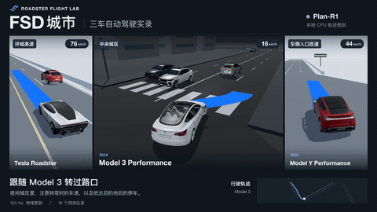
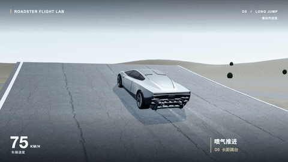

# Roadster Flight Lab

[English](README.md) · [简体中文](README.zh-CN.md) · [繁體中文](README.zh-TW.md) · [日本語](README.ja.md) · [한국어](README.ko.md) · [Deutsch](README.de.md) · [Français](README.fr.md) · [Español](README.es.md) · **Português (Brasil)**

**Três carros no mesmo campo de provas.** Salte com o Roadster usando os propulsores a gás frio, sinta a suspensão do Model 3 trabalhar em uma curva inclinada ou acompanhe, no Model Y, a trajetória que um modelo executado no próprio computador escolhe para atravessar a cidade.

[Baixar para Windows x64](https://github.com/colasun-ai/Roadster-Flight-Lab/releases/download/v0.10.1/Roadster-Flight-Lab-0.10.1-Windows-x64.exe) · [Baixar para Mac com Apple Silicon](https://github.com/colasun-ai/Roadster-Flight-Lab/releases/download/v0.10.1/Roadster-Flight-Lab-0.10.1-Mac-arm64.zip) · [Notas da versão e somas de verificação](https://github.com/colasun-ai/Roadster-Flight-Lab/releases/tag/v0.10.1)

## O simulador em movimento

| FSD na cidade · Roadster, Model 3 e Model Y | Rampa D5 · Salto do Roadster com propulsão a gás frio |
| --- | --- |
| [](https://colasun-ai.github.io/Roadster-Flight-Lab/media/fsd-city.mp4) | [](https://colasun-ai.github.io/Roadster-Flight-Lab/media/d5-jump.mp4) |
| [▶ Assistir ao vídeo completo · 0:20](https://colasun-ai.github.io/Roadster-Flight-Lab/media/fsd-city.mp4) | [▶ Assistir ao vídeo completo · 0:20](https://colasun-ai.github.io/Roadster-Flight-Lab/media/d5-jump.mp4) |


## Sua primeira volta

Na primeira abertura, a interface aparece em inglês. Na Tesla Garage, abra **Language** e escolha **Português (Brasil)**. A garagem reabre no seu idioma e guarda a preferência para a próxima sessão. Todos os idiomas funcionam sem conexão.

Escolha o Roadster e clique em **Começar a dirigir**. Abra a área de rampas, selecione **D5** e vá até a largada. Experimente o salto só com os motores elétricos. Depois, faça a mesma aproximação segurando **Shift** para sentir o efeito do empuxo traseiro.

## Na garagem

| Carro | Experimente |
| --- | --- |
| Tesla Roadster | Dez bocais de gás frio permitem acelerar, subir, pairar, rolar e pousar. Alterne entre os modos Stabilized, Manual e Chaos. O compressor repõe o gás durante a condução. |
| Tesla Model 3 Performance 2018 | Compare os modos Standard, Performance e Track no mesmo trecho. O modelo de tração integral com dois motores combina frenagem regenerativa e mecânica. A referência de 450 hp vem de um teste de época. |
| Tesla Model Y Performance 2026 | A versão voltada ao mercado norte-americano tem parâmetros próprios de potência, chassi e amortecimento. Compare os movimentos da carroceria com os do Model 3 na mesma curva. |

## Vinte pistas para testar a suspensão

Há subidas com inclinação de 8% a 45%, cristas e depressões, curvas inclinadas, trechos de torção do chassi e rampas com diferentes áreas de aterrissagem. A pista exibida e a superfície de colisão compartilham os mesmos vértices. Uma rampa de 45% sobe 45 m a cada 100 m na horizontal.


## Dirigindo na cidade

Marque um destino no mapa e ative o FSD. A malha tem 61,43 km de vias expressas, marginais, acessos, túneis e retornos. O Plan-R1 calcula localmente 16 posições e orientações do carro ao longo de oito segundos. O controlador segue a trajetória escolhida e leva em conta o tráfego e a distância de frenagem. A faixa azul mostra o trecho imediatamente à frente do veículo. Assuma o volante a qualquer momento com WASD ou a barra de espaço.


## Teclado

| Tecla | Ação |
| --- | --- |
| W / S · A / D | Acelerar, frear ou dar ré · virar à esquerda ou à direita |
| Espaço | Acionar o freio de mão ou assumir o controle na cidade |
| C · R · Esc | Trocar a câmera · reposicionar o carro · abrir a garagem |
| Shift · J / K · H | Ativar o empuxo traseiro · controlar o empuxo vertical · alternar o voo pairado |
| T | Trocar o modo de voo do Roadster ou o modo de condução do Model 3 |

## Instalação

**Windows 11 com processador Intel ou AMD.** Baixe o EXE portátil e abra-o com um clique duplo. Reserve cerca de 3 GB de espaço temporário para a extração. Como o executável não tem assinatura digital, o Windows pode exibir um aviso de editor desconhecido.

**Mac com Apple Silicon.** Descompacte o ZIP e abra o aplicativo. O pacote tem assinatura ad hoc e não foi autenticado pela Apple. As duas versões incluem os veículos, as texturas, o motor de física e o modelo de navegação que roda na CPU.

## Resultados do simulador

A física é atualizada 120 vezes por segundo. Os três carros completaram as vinte pistas no teste de regressão, totalizando sessenta percursos. Em 1.788 amostras, a diferença entre a altura visível e a altura de colisão ficou dentro de 3 mm. Em testes anteriores do simulador, o Roadster foi de 0 a 100 km/h em 3,502 s com tração elétrica e em 1,0411 s com auxílio dos propulsores. [Dados dos testes de pista](reports/slope-park/驾驶验证.md)

## Compilar a partir do código-fonte

Use Node.js 22.12 ou superior e npm. O repositório inclui os modelos originais, as malhas preparadas para condução, as texturas, o vocabulário de ações e os pesos do Plan-R1. A primeira instalação das dependências requer internet.

```sh
git clone https://github.com/colasun-ai/Roadster-Flight-Lab.git
cd Roadster-Flight-Lab
npm ci
npm run dev
```

Para gerar o EXE x64 no Windows, instale o Python 3.10 ou superior e execute:

```sh
python scripts/fsd/prepare_windows_runtime.py
node scripts/fsd/smoke_portable.cjs
npm run pack:win
```

No Mac com Apple Silicon, instale as ferramentas de linha de comando do Xcode e o uv. Execute:

```sh
python3 scripts/fsd/bootstrap.py
npm run pack:mac
```

Para verificar a física, os veículos, o FSD e as rampas:

```sh
npm test
npm run test:vehicles
npm run test:fsd
node tests/slope-park.test.js
```

Os pacotes ficam em `desktop-build/`. A pasta `print/` contém o Roadster em formato 3MF na escala 1:24 e o script que permite recriá-lo.

## Créditos e licenças

Os modelos dos veículos são de asiphy007, Ameer Studio, BloxBloger e vecarz / heynic. A cidade adapta o cenário histórico do DriveScene Studio, de Peixin, e usa texturas de piso da Poly Haven. O planejamento local usa o Plan-R1, de Xiaolong Tang e colaboradores. O modelo do Model Y está sob a licença CC BY-NC 4.0, que limita seu uso a fins não comerciais. O projeto de origem não informa uma licença específica para os pesos do Plan-R1. Roadster Flight Lab é um simulador independente. [Autoria, licenças e alterações](CREDITS.md)
