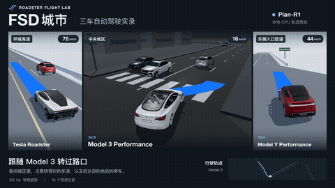
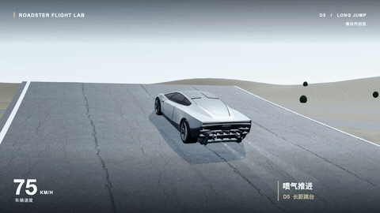

# Roadster Flight Lab

[English](README.md) · [简体中文](README.zh-CN.md) · **繁體中文** · [日本語](README.ja.md) · [한국어](README.ko.md) · [Deutsch](README.de.md) · [Français](README.fr.md) · [Español](README.es.md) · [Português (Brasil)](README.pt-BR.md)

**在同一個離線駕駛模擬器裡，把 Roadster 送上飛坡，給 Model 3 做坡起測試，或者坐進 Model Y，觀察本地模型怎樣在城市裡選擇車道。**

[下載 Windows x64 便攜版](https://github.com/colasun-ai/Roadster-Flight-Lab/releases/download/v0.10.1/Roadster-Flight-Lab-0.10.1-Windows-x64.exe) · [下載 Apple Silicon Mac 版](https://github.com/colasun-ai/Roadster-Flight-Lab/releases/download/v0.10.1/Roadster-Flight-Lab-0.10.1-Mac-arm64.zip) · [所有釋出檔案與校驗值](https://github.com/colasun-ai/Roadster-Flight-Lab/releases/tag/v0.10.1)

## 模擬器實錄

| FSD 城市 · Roadster、Model 3、Model Y 三車同框 | D5 飛坡 · Roadster 冷氣推進飛躍 |
| --- | --- |
| [](https://colasun-ai.github.io/Roadster-Flight-Lab/media/fsd-city.mp4) | [](https://colasun-ai.github.io/Roadster-Flight-Lab/media/d5-jump.mp4) |
| [▶ 播放完整影片 · 0:20](https://colasun-ai.github.io/Roadster-Flight-Lab/media/fsd-city.mp4) | [▶ 播放完整影片 · 0:20](https://colasun-ai.github.io/Roadster-Flight-Lab/media/d5-jump.mp4) |


**介面語言**　首次啟動使用英語。在 Tesla Garage 左側的 Language 下拉式選單中選擇繁體中文，應用會重新開啟車庫並記住選擇。8 種語言均可離線使用，中文提供簡體和繁體。

## 第一次上車

**Windows 11 Intel / AMD** 下載上面的 EXE，雙擊開啟。便攜啟動器會先把遊戲和本地推理環境解壓到臨時目錄，請預留約 3 GB 空間。Windows 版未做 Authenticode 簽名，SmartScreen 可能提示釋出者未知。**Apple Silicon Mac** 下載 ZIP，解壓後開啟 App。Mac 版採用 Ad-hoc 簽名，未經 Apple 公證。兩個桌面包都自帶車輛、貼圖、物理引擎與模型，遊戲時可斷網。

| 想試什麼 | 從車庫出發 |
| --- | --- |
| 第一次飛躍 | 選 **Roadster → 開始駕駛 → 坡道試驗區 → D5 長距大跳**。看縱剖面和建議車速，點「前往起點」。先用電驅跑一趟，再按 Shift 對比後噴助推。 |
| 比較底盤 | 先開 **Model 3 Performance** 上 A5 的 45% 坡，再換 **Model Y Performance** 走同一條線。觀察入坡時的俯仰、軸荷變化和坡頂接地。 |
| 觀察城市自動駕駛 | 選車後點 **進入 FSD 城市 → 地圖選點**，點想去的位置並啟用 FSD。藍色軌跡從車頭向前延伸。WASD 或空格可以隨時接管。 |

## 三輛車，兩種場地

| 車輛 | 在模擬器裡可以體驗 |
| --- | --- |
| Tesla Roadster | 四驅電機、10 個冷氣噴嘴、自動補氣、懸浮與空中姿態控制。實驗設定下可以靠後噴跑直線，也可以關掉穩定輔助自己控制落地姿態。 |
| 2018 Model 3 Performance | 按當年 Performance 測試車標定的雙電機 AWD、前後軸動力分配、再生制動，以及 Standard、Performance、Track 三種模式。450 hp 為歷史實車測試參考。 |
| 2026 Model Y Performance | 獨立的美國版 Performance 動力、車身與懸掛引數，保留 SUV 的坐姿和輪拱幾何。適合與 Model 3 在相同制動、坡面及轉彎條件下對照。 |

**實體試車場**有 20 條專用坡道。A 區測爬坡和坡起，B 區有波浪路與搓板路，C 區測試側傾、反向扭轉和交叉軸，D 區包含桌面跳臺、連跳和斷崖。可見坡面和碰撞面共用頂點。45% 坡表示水平前進 100 米時升高 45 米。


**FSD 城市**約有 61.43 公里道路中心線，包含市區街道、環城高速、輔路、匝道、隧道和掉頭連線。地圖選點後，導航尋找可達的道路。交通車會排隊、讓行並爭用路口。本地 Plan-R1 根據車輛歷史、路網和周圍車流，每次生成未來 8 秒的 16 個姿態。控制層處理跟蹤、交通間隙與制動，螢幕上的藍線顯示當前可見的預測路段。可在駕駛記錄裡對照模型輸出與實際軌跡。這是遊戲中的獨立研究功能，與 Tesla 車載 FSD 無關。


## 鍵盤操作

| 按鍵 | 操作 |
| --- | --- |
| W / S，A / D | 加速、制動或倒車，向左或向右轉向 |
| 空格，C，R，Esc | 手剎、切換視角、重置車輛、開啟車庫 |
| Shift，J / K，H | Roadster 後噴、升降、懸浮 |
| 方向鍵，T | Roadster 空中姿態、飛航模式；Model 3 的 T 切換駕駛模式 |
| L | Model 3 車燈 |

## 怎樣驗證駕駛效果

Three.js 渲染車輛和場景，Rapier 以 **120 Hz** 固定步長推進剛體。三個控制器共用世界和地面，分別配置動力、輪胎、轉向與懸掛。坡道驗證讓每輛車從靜止起步，靠車輛控制器駛過全部 20 條車道，共 **60 趟**。另用 **1,788 次射線**檢查渲染坡面和碰撞坡面，高度差均在 3 毫米容差內。Apple Silicon 桌面包另完成 A5 爬坡及 D5 離地後重新接地測試。[坡道測試與測量](reports/slope-park/驾驶验证.md)

Roadster 的歷史模擬基準為純電 0–100 km/h **3.502 s**，電驅加後噴為 **1.0411 s**。兩項都是本專案的模擬成績。Model 3 的資料按時間區分實車測試、廠方宣傳和模擬器成績，並分別記錄是否扣除起步 rollout。[Model 3 動力報告](reports/model3-physics-report.md) · [Model Y 動力報告](reports/model-y-physics-report.md)

## 從原始碼執行

需要 Node.js 22.12 或更高相容版本及 npm。倉庫直接提供原始車輛、可駕駛 GLB、道路貼圖、交通車、動作詞典和 Plan-R1 檢查點。首次安裝開發依賴需要聯網。

```sh
git clone https://github.com/colasun-ai/Roadster-Flight-Lab.git
cd Roadster-Flight-Lab
npm ci
npm run dev
```

開啟終端顯示的本地地址可手動駕駛。要在開發版啟用城市模型，或構建內含模型的桌面包，先準備對應系統的執行環境。

| 平臺 | 準備與打包 |
| --- | --- |
| Windows x64 | 安裝 Python 3.10+，執行 `python scripts/fsd/prepare_windows_runtime.py`。指令碼校驗 33 個固定下載檔案並組裝獨立執行環境。執行 `node scripts/fsd/smoke_portable.cjs` 可驗證一次真實推理，再執行 `npm run pack:win`。 |
| macOS Apple Silicon | 準備 Xcode 命令列工具、Python 與 uv，執行 `python3 scripts/fsd/bootstrap.py`，再執行 `npm run pack:mac`。簽名及驗證由打包指令碼完成。 |

產物位於 `desktop-build/`。開發桌面入口為 `npm run build` 後執行 `npm run desktop`。Windows 驗證流程可從原始碼構建，也可下載一個指定 Release 的 EXE，直接對其內建模型、車庫、車輛切換和城市進出做檢查。[Windows 驗證流程](.github/workflows/windows.yml)

```sh
npm test
npm run test:vehicles
npm run test:fsd
node tests/slope-park.test.js
```

| 目錄 | 內容 |
| --- | --- |
| `src/vehicles`、`src/vehicle`、`src/thrusters` | 車型配置、底盤與推進器 |
| `src/world`、`src/fsd` | 場地、路網、交通、路線、模型適配與軌跡顯示 |
| `assets/originals`、`public/models`、`public/textures` | 原始素材、可駕駛模型、交通車和離線貼圖 |
| `desktop`、`fsd-runtime`、`scripts/fsd` | 桌面入口、推理程式碼與權重、各平臺執行環境準備指令碼 |
| `print` | Roadster 1:24 靜態列印版 3MF、生成指令碼和切片說明 |

## 素材署名

感謝 asiphy007、Ameer Studio、BloxBloger、vecarz / heynic、Peixin、Poly Haven 和 Plan-R1 作者。各素材沿用各自條款，其中 **Model Y 素材為 CC BY-NC 4.0，僅限非商業使用**。倉庫收錄上游原始權重，並保留其許可說明的邊界。[完整署名、原作連結與修改記錄](CREDITS.md)

原車輪處理也可獨立復現。使用 Python 3.12、NumPy 2.3.5、SciPy 1.18.1 和 manifold3d 3.5.4，執行下列命令會生成一份新檔案。

```sh
python scripts/roadster-mesh-process.py --input "assets/originals/tesla roadtser 2026.glb" --output rebuilt/roadster.glb --report rebuilt/wheels.json
```
